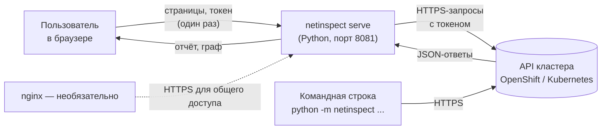
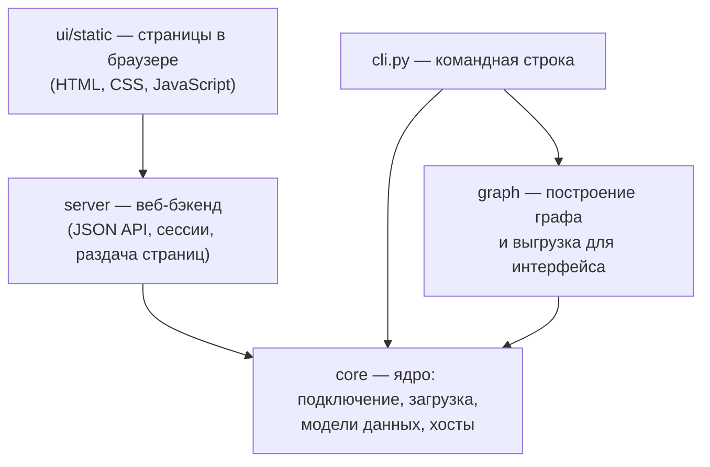
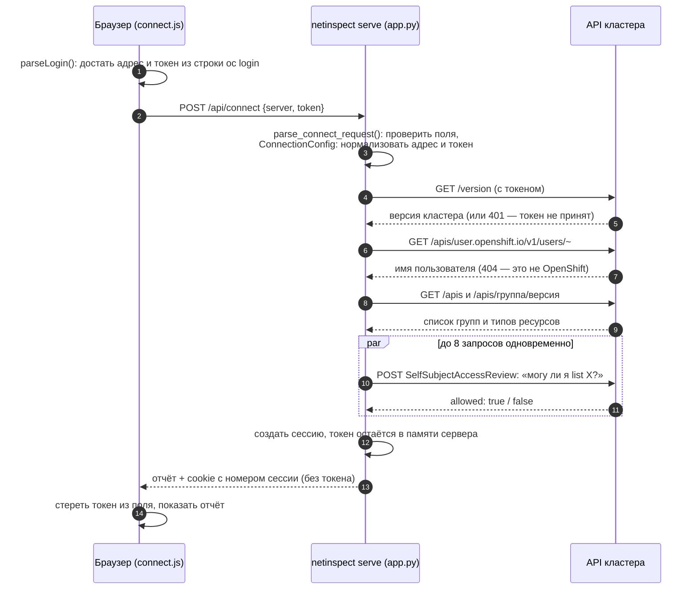

# netinspect — полное руководство

Документ для тех, кто **не программирует на Python**, но хочет понимать, как устроено
приложение: что оно делает, как подключается к кластеру, как обрабатывает манифесты,
какие библиотеки использует и зачем нужна каждая функция.

> Как читать. Разделы 1–4 — общая картина: что это, термины, схема, запуск.
> Разделы 5–9 — как всё работает по шагам. Раздел 10 — подробный справочник по
> каждому файлу и функции. В конце — тесты, частые ошибки и ограничения.

## Содержание

1. [Что такое netinspect](#1-что-такое-netinspect)
2. [Словарь терминов](#2-словарь-терминов)
3. [Как устроено приложение](#3-как-устроено-приложение)
4. [Как запустить](#4-как-запустить)
5. [Подключение к кластеру: шаг за шагом](#5-подключение-к-кластеру-шаг-за-шагом)
6. [Безопасность токена](#6-безопасность-токена)
7. [Как загружаются и обрабатываются манифесты](#7-как-загружаются-и-обрабатываются-манифесты)
8. [Как строится граф связей](#8-как-строится-граф-связей)
9. [Веб-интерфейс](#9-веб-интерфейс)
10. [Справочник: каждый файл и каждая функция](#10-справочник-каждый-файл-и-каждая-функция)
11. [Используемые библиотеки](#11-используемые-библиотеки)
12. [Команды командной строки](#12-команды-командной-строки)
13. [Тесты](#13-тесты)
14. [Частые ошибки и что делать](#14-частые-ошибки-и-что-делать)
15. [Ограничения и планы](#15-ограничения-и-планы)

---

## 1. Что такое netinspect

**netinspect** — инструмент диагностики сетевых правил в кластере OpenShift или
Kubernetes с сервис-мешем **Istio**.

В таком кластере путь запроса от пользователя до приложения описывается несколькими
отдельными объектами (манифестами): Gateway → VirtualService → DestinationRule →
Service → EndpointSlice, а в OpenShift ещё Route. Они ссылаются друг на друга по
именам. Если в одной ссылке опечатка или объект удалён, трафик не доходит, а найти
проблему вручную долго: приходится открывать десятки YAML-файлов.

netinspect делает это автоматически:

- **подключается к кластеру по вашему личному токену** и проверяет, что вам можно читать;
- **находит все ресурсы Istio**, которые есть в кластере;
- **строит граф связей** «кто на кого ссылается» и рисует его в браузере;
- **подсвечивает проблемы**: ссылку на несуществующий объект, отсутствующий subset,
  сервис без работающих подов.

Приложение **только читает** данные кластера и ничего в нём не меняет.

---

## 2. Словарь терминов

### Кластер и Istio

| Термин | Простое объяснение |
|---|---|
| **Kubernetes** | Система, которая запускает приложения в контейнерах на множестве серверов. Кластер — набор таких серверов. |
| **OpenShift** | Kubernetes от Red Hat с дополнениями: веб-консоль, Route, пользователи. |
| **API кластера** | «Окно» для программ: адрес вида `https://api.кластер:6443`, через который читают и меняют объекты кластера. Им пользуются `oc`, `kubectl` и netinspect. |
| **Манифест** | Описание одного объекта кластера в формате YAML или JSON: что это (`kind`), как называется (`metadata.name`), где лежит (`metadata.namespace`) и как настроено (`spec`). |
| **Namespace** | «Папка» внутри кластера, например `prod`, `staging`. Объекты с одинаковым именем в разных namespace — разные объекты. |
| **Istio** | Сервис-меш: прослойка, которая управляет сетевым трафиком между приложениями по правилам из своих манифестов. |
| **Gateway** | Правило Istio: «на каких хостах и портах принимать внешний трафик». |
| **VirtualService (VS)** | Правило Istio: «запросы на такой-то хост отправлять в такой-то сервис», с весами, путями и т.д. |
| **DestinationRule (DR)** | Правило Istio для конкретного сервиса: подмножества версий (**subset**, например `v1`, `v2`), балансировка, TLS. |
| **Service** | Объект Kubernetes: постоянное имя (например `reviews`), за которым стоят поды приложения. |
| **EndpointSlice** | Список реальных адресов подов за сервисом и их готовность (**ready**). |
| **Route** | Объект OpenShift: публикует сервис наружу по имени хоста. |
| **ServiceEntry, Sidecar, AuthorizationPolicy…** | Другие ресурсы Istio. netinspect находит их и показывает права на чтение; в граф пока входят только основные (см. раздел 15). |
| **FQDN** | Полное имя сервиса внутри кластера: `reviews.prod.svc.cluster.local` = имя `reviews`, namespace `prod`, домен кластера `cluster.local`. |
| **Wildcard-хост** | Хост со звёздочкой: `*.example.com` подходит для `a.example.com`, `a.b.example.com`. |

### Доступ и безопасность

| Термин | Простое объяснение |
|---|---|
| **Токен** | Длинная строка вида `sha256~…`, ваш «пропуск» в API кластера. Получают командой `oc whoami -t` или в консоли OpenShift («Copy login command»). Кто знает токен, действует от вашего имени, поэтому его берегут. |
| **RBAC** | Система прав в кластере: кому что можно (читать, изменять) и в каких namespace. |
| **SelfSubjectAccessReview** | Официальный способ спросить у кластера: «могу ли я выполнить такое-то действие?». netinspect так проверяет, может ли он читать каждый тип ресурса. |
| **HTTPS / TLS** | Шифрованное соединение. Сервер предъявляет **сертификат**, клиент проверяет его подлинность. |
| **CA (центр сертификации)** | Тот, кто подписал сертификат. Компьютер доверяет сертификату, если доверяет подписавшему его CA. Список доверенных CA хранится в операционной системе. |
| **Сессия / cookie** | Браузер получает от сервера случайный номер сессии (cookie) и предъявляет его в следующих запросах, чтобы не вводить токен заново. |
| **CSRF** | Атака, когда чужой сайт заставляет ваш браузер отправить запрос к вашему приложению. Защита описана в разделе 6. |
| **CSP** | Заголовок, который запрещает браузеру выполнять скрипты и грузить файлы откуда-либо, кроме самого приложения. |

### Программирование

| Термин | Простое объяснение |
|---|---|
| **Python** | Язык, на котором написано приложение. Нужна версия 3.10 или новее. |
| **Стандартная библиотека** | Набор модулей, который входит в сам Python. Ничего дополнительно устанавливать не нужно. |
| **Модуль** | Один файл `.py`. **Пакет** — папка с модулями (здесь `netinspect/`). |
| **Функция** | Именованный кусок кода, который получает данные и возвращает результат. Например, `to_fqdn("reviews", "prod")` возвращает `reviews.prod.svc.cluster.local`. |
| **Класс / объект** | Шаблон «вещи» с данными и действиями. Например, класс `ApiClient` — «клиент API»; объект этого класса умеет делать запросы к конкретному кластеру. **Метод** — функция внутри класса. |
| **Исключение (ошибка)** | Сигнал «что-то пошло не так», который прерывает работу и передаётся выше, пока его не обработают. Например, `AuthError` — «токен не принят». |
| **JSON / YAML** | Текстовые форматы данных. Кластер отвечает в JSON; люди обычно пишут манифесты в YAML. |
| **HTTP-запрос** | Обращение к серверу: `GET` — получить данные, `POST` — отправить данные. Ответ имеет код: 200 — успех, 401 — не авторизован, 403 — запрещено, 404 — не найдено. |
| **Бэкенд / фронтенд** | Бэкенд — программа на сервере (здесь на Python). Фронтенд — то, что работает в браузере (HTML, CSS, JavaScript). |
| **HTML / CSS / JavaScript** | Разметка страницы, её оформление и поведение в браузере. |
| **nginx** | Веб-сервер. Необязателен: нужен, если приложение ставят на общий сервер с HTTPS. |
| **Тест** | Маленькая программа, которая автоматически проверяет, что функция работает правильно. |

---

## 3. Как устроено приложение

### 3.1. Общая схема



Браузер **не обращается к кластеру напрямую**: так запрещают правила безопасности
браузеров (CORS), и браузер не знает CA кластера. Поэтому все запросы к кластеру
делает программа на Python (`serve`), а браузер общается только с ней.

### 3.2. Слои кода

Код разделён на слои; каждый слой пользуется только теми, что ниже него.



### 3.3. Файлы проекта

```
AEFRApp/                      ← корень проекта (репозиторий)
├── README.md                 ← краткое описание и команды
├── docs/GUIDE.md             ← этот документ
├── pyproject.toml            ← паспорт пакета: имя, версия, зависимости (их нет)
├── deploy/nginx/             ← готовые настройки nginx (необязательно)
├── netinspect/               ← код приложения
│   ├── __main__.py           ← точка входа: python -m netinspect
│   ├── cli.py                ← команды connect, get, graph, serve
│   ├── core/                 ← ядро
│   │   ├── config.py         ← параметры подключения (адрес, токен)
│   │   ├── client.py         ← HTTP-клиент API кластера
│   │   ├── errors.py         ← виды ошибок
│   │   ├── discovery.py      ← какие API есть в кластере
│   │   ├── access.py         ← проверка прав, отчёт о подключении
│   │   ├── resources.py      ← справочник типов ресурсов
│   │   ├── fetcher.py        ← загрузка манифестов (из кластера или папки)
│   │   ├── model.py          ← модели: ресурс, узел, связь, граф
│   │   └── hosts.py          ← работа с именами хостов
│   ├── graph/                ← граф
│   │   ├── builder.py        ← построение связей и поиск проблем
│   │   ├── traverse.py       ← выделение части графа
│   │   └── render_web.py     ← выгрузка графа для страницы «Граф»
│   ├── server/               ← веб-бэкенд
│   │   ├── app.py            ← обработка запросов браузера
│   │   └── sessions.py       ← сессии пользователей
│   └── ui/                   ← интерфейс
│       ├── theme.py          ← цвета и шрифты (единый источник)
│       └── static/           ← страницы, скрипты, стили, шрифты
└── tests/                    ← автоматические тесты и тестовые манифесты
```

---

## 4. Как запустить

Нужен только Python 3.10+. Ничего устанавливать не надо.

```bash
cd AEFRApp                     # папка проекта
python3 -m netinspect serve    # запуск
```

Откройте в браузере **http://127.0.0.1:8081/**, вставьте строку из консоли OpenShift
(ваше имя → «Copy login command»), нажмите «Проверить подключение».

Остановить — `Ctrl+C` в терминале. Приложение доступно только с этого же компьютера.

Посмотреть граф на тестовых данных без кластера:

```bash
python3 -m netinspect graph --from-dir tests/fixtures -A   # создаст папку web/
python3 -m netinspect serve                                # затем «Граф связей» в меню
```

---

## 5. Подключение к кластеру: шаг за шагом

### 5.1. Что видит пользователь

1. Вставляет строку `oc login --token=sha256~… --server=https://api…:6443` в поле
   «Строка подключения». Поля «Адрес API» и «Токен» заполняются сами (их можно
   ввести и вручную).
2. Нажимает «Проверить подключение».
3. Видит результат: версию кластера, пользователя, найденные API Istio, таблицу
   «ресурс → можно ли читать». Либо понятную ошибку с подсказкой.

### 5.2. Что происходит внутри



Подробно по шагам:

**Шаг 1. Разбор строки в браузере.** Функция `parseLogin` в `connect.js` ищет в
тексте `--token=…` и `--server=…` (или адрес сразу после `oc login`). Если вставлен
просто токен или просто адрес, распознаёт и это. Под полем появляются отметки
«✓ адрес API», «✓ токен».

**Шаг 2. Отправка на сервер.** Браузер делает запрос `POST /api/connect` с телом
`{"server": "...", "token": "..."}` и служебным заголовком `X-Netinspect: 1`
(защита от CSRF, раздел 6).

**Шаг 3. Проверка введённых данных.** На сервере `parse_connect_request` проверяет,
что оба поля заполнены и являются текстом. Затем создаётся объект
`ConnectionConfig`, который:
- добавляет `https://`, если схема не указана, и убирает лишний `/` в конце;
- проверяет, что в адресе есть имя сервера и нет пробелов;
- убирает приставку `Bearer ` у токена и запрещает пробелы внутри токена.

**Шаг 4. Создание клиента.** `ApiClient` готовит HTTPS-соединение. Сертификат
кластера **всегда проверяется** по доверенным CA операционной системы — так же,
как это делают браузер и `oc`. Если в системе настроен прокси (`HTTPS_PROXY`), он
используется.

**Шаг 5. Запросы к кластеру** (функция `connection_report` в `core/access.py`):

| № | Запрос | Зачем |
|---|---|---|
| 1 | `GET /version` | Первая проверка: адрес верный, токен принят. Если токен неверный, здесь же будет ошибка 401. |
| 2 | `GET /apis/user.openshift.io/v1/users/~` | Имя пользователя. Ответ 404 означает «это не OpenShift», и пользователь показывается как `n/a`. |
| 3 | `GET /apis` | Список всех групп API в кластере. Отбираются группы, оканчивающиеся на `.istio.io`, а также `discovery.k8s.io` (EndpointSlice) и `route.openshift.io` (Route). |
| 4 | `GET /api/v1` и `GET /apis/<группа>/<версия>` | Типы ресурсов в каждой отобранной группе (VirtualService, Gateway, ServiceEntry, AuthorizationPolicy…). Служебные подресурсы вроде `virtualservices/status` отбрасываются. |
| 5 | `POST /apis/authorization.k8s.io/v1/selfsubjectaccessreviews` | Для каждого типа: «могу ли я читать (`list`) его во всём кластере?». До 8 запросов одновременно, чтобы было быстро. |

Каждый запрос несёт заголовок `Authorization: Bearer <токен>`. Ожидание ответа —
не больше 15 секунд.

**Шаг 6. Сессия.** Если всё прошло, сервер создаёт сессию (`SessionStore.create`):
случайный номер из 43 символов, внутри — готовый клиент с токеном и отчёт. Браузер
получает только номер в cookie `netinspect_session`; токен обратно не отправляется.

**Шаг 7. Отображение.** Браузер стирает токен из поля ввода и показывает отчёт:
плитки (версия, пользователь, число ресурсов Istio, доля доступных для чтения) и
таблицу с фильтром «Все / Istio / Kubernetes» и поиском.

**Шаг 8. Повторное открытие страницы.** При загрузке страница спрашивает
`GET /api/session`. Если сессия жива, отчёт показывается без повторного ввода токена.
Сессия живёт 8 часов без активности. Кнопка «Отключиться» (`POST /api/disconnect`)
удаляет её сразу. Перезапуск `serve` удаляет все сессии.

### 5.3. Какие бывают ошибки подключения

| Что случилось | Код ответа API | Что видит пользователь |
|---|---|---|
| Пустой адрес или токен, пробелы в токене | 400 | «Проверьте введённые данные» |
| Кластер вернул 401 | 401 | «Токен не принят» + подсказка `oc whoami -t` |
| Сертификат кластера не прошёл проверку | 502 | «Ошибка TLS-сертификата» + ссылка на README |
| Кластер недоступен (нет сети, неверный адрес) | 502 | «Кластер недоступен» + что проверить |
| По адресу не API Kubernetes (404 на `/version`) | 502 | «Кластер недоступен: похоже, адрес не тот» |
| Бэкенд не запущен | — | «Сервер netinspect недоступен» + как запустить |

Перевод внутренних ошибок в понятные сообщения делает функция `_failure_from`
(`server/app.py`), а коды HTTP в ошибки — метод `_map_http_error` (`core/client.py`).

### 5.4. Сертификат кластера (TLS)

Сертификат проверяется **всегда**; отключить проверку нельзя. Если CA кластера
внутренний и не установлен в систему, появится «Ошибка TLS-сертификата». Решение —
один раз добавить CA в систему (раздел README «TLS-сертификат кластера») или, без
прав администратора, указать свой файл с сертификатами через переменную
`SSL_CERT_FILE`.

---

## 6. Безопасность токена

| Мера | Где сделано | Что даёт |
|---|---|---|
| Токен не сохраняется в браузере | `connect.js` | После подключения поле очищается; нет записи в localStorage и в cookie. |
| Токен живёт только в памяти сервера | `server/sessions.py` | На диск не пишется. Перезапуск сервера его удаляет. |
| Cookie сессии `HttpOnly; SameSite=Strict` | `ApiHandler._send` | JavaScript не может прочитать cookie; браузер не отправит её с чужого сайта. |
| Заголовок `X-Netinspect: 1` и `Content-Type: application/json` | `ApiHandler._read_json` | Защита от CSRF: чужой сайт не может отправить такой запрос. |
| Токен не попадает в логи и тексты ошибок | `ConnectionConfig.__repr__`, `ApiClient._error_detail`, `log_message` | В логах — только маска `****1234`; если кластер вернул токен в тексте ошибки, он заменяется на `****`. |
| Сервер слушает только `127.0.0.1` | `serve --listen` | Подключиться можно только с этого компьютера. При другом адресе выводится предупреждение. |
| Сертификат кластера всегда проверяется | `ApiClient._make_ssl_context` | Токен не уйдёт на поддельный сервер. |
| Строгий CSP и защитные заголовки | `SECURITY_HEADERS` | Браузер выполняет только скрипты самого приложения; страницу нельзя встроить в чужой сайт. |
| Secret-ресурсы никогда не загружаются | `FORBIDDEN_KINDS` | Пароли и ключи кластера не попадают в приложение. |
| Ограничение размера запроса 512 КБ | `MAX_BODY` | Защита от слишком больших запросов. |

---

## 7. Как загружаются и обрабатываются манифесты

Манифесты нужны для построения графа (команды `graph` и `get`).

### 7.1. Откуда берутся манифесты

Есть два «источника» с одинаковым поведением (`core/fetcher.py`):

| Источник | Когда используется | Как работает |
|---|---|---|
| **ClusterSource** — из кластера | По умолчанию, если задан `--server` и токен | Делает запросы к API кластера. |
| **DirectorySource** — из папки | `--from-dir папка` | Читает файлы `.json` (и `.yaml`/`.yml`, если установлен PyYAML) из папки и подпапок. Удобно, если доступа к кластеру нет: можно выгрузить манифесты командой `oc get … -o json` и разобрать их. |

### 7.2. Какие типы загружаются

Список задан в справочнике `REGISTRY` (`core/resources.py`):

| Тип | Группа API | Версии (по приоритету) | Короткое имя |
|---|---|---|---|
| Gateway | networking.istio.io | v1, v1beta1 | gw |
| VirtualService | networking.istio.io | v1, v1beta1 | vs |
| DestinationRule | networking.istio.io | v1, v1beta1 | dr |
| Service | (основная группа) | v1 | svc |
| EndpointSlice | discovery.k8s.io | v1 | eps |
| Route | route.openshift.io | v1 | route (только в OpenShift) |

**Secret не загружается никогда** — даже если файл с ним лежит в папке.

### 7.3. Загрузка из кластера по шагам

1. **Выбор версий** (`discover`). Для каждой группы спрашиваем у кластера, какие
   версии он поддерживает, и берём первую подходящую из списка приоритетов. Так
   приложение работает и со старыми (`v1beta1`), и с новыми (`v1`) версиями Istio.
2. **Пути запросов.** Для каждого типа и namespace:
   `/apis/<группа>/<версия>/namespaces/<ns>/<тип>`; для всех namespace —
   `/apis/<группа>/<версия>/<тип>`; для основной группы — `/api/v1/...`.
3. **Постраничная загрузка** (`ApiClient.list_all`). Кластер отдаёт до 500 объектов
   за раз; если есть продолжение, приложение запрашивает следующую страницу.
4. **Нет прав — не страшно.** Если на какой-то тип ответ 403, он пропускается, а в
   предупреждения добавляется «нет прав на list». Остальные типы загружаются.
   Ошибки «токен не принят» и TLS прерывают загрузку целиком: дальше смысла нет.

### 7.4. Чтение из папки

1. Рекурсивно собираются файлы `.json`, `.yaml`, `.yml`.
2. В одном файле может быть: один объект; список `kind: List` с полем `items`;
   несколько YAML-документов через `---`. Все варианты разворачиваются в плоский список.
3. Битый файл не останавливает работу: он попадает в предупреждения.
4. Если PyYAML не установлен, YAML-файлы пропускаются с понятным предупреждением.

### 7.5. Очистка манифеста

`clean_manifest` удаляет служебный «шум», который мешает читать манифест:
- `metadata.managedFields` — история, кто и когда менял поля;
- аннотацию `kubectl.kubernetes.io/last-applied-configuration` — копию манифеста.

### 7.6. Модель ресурса

Каждый манифест превращается в объект `Resource` (`core/model.py`) с полями:
`kind` (тип), `namespace`, `name`, `spec` (настройки) и `raw` (весь манифест после
очистки). Уникальный ключ — `Kind/namespace/name`, например `VirtualService/prod/reviews`.
Если namespace не указан (бывает в файлах), используется `default`.

---

## 8. Как строится граф связей

### 8.1. Что такое граф здесь

- **Узел** — один ресурс (или ожидаемый, но не найденный ресурс).
- **Ребро (связь)** — «этот ресурс ссылается на тот», направлено по ходу трафика.
- **Бейдж** — короткая пометка на узле: хост, порт, `subset v1 ✓`, `3 ready`.
- **Проблема** — текст, почему с узлом что-то не так.

Колонки по ходу трафика:

```
Gateway / Route  →  VirtualService  →  DestinationRule  →  Service / внешний хост  →  EndpointSlice
```

### 8.2. Нормализация хостов (`core/hosts.py`)

В Istio хосты часто пишут коротко, и приложение должно понимать, что это один и тот
же сервис. Функция `to_fqdn(хост, namespace)` разворачивает имя до полного:

| Указано в манифесте (namespace манифеста `prod`) | Полное имя |
|---|---|
| `reviews` | `reviews.prod.svc.cluster.local` |
| `reviews.staging` | `reviews.staging.svc.cluster.local` |
| `reviews.staging.svc` | `reviews.staging.svc.cluster.local` |
| `reviews.staging.svc.cluster.local` | без изменений |
| `api.example.com` | без изменений (внешний хост) |
| `Reviews.` | `reviews.prod.svc.cluster.local` (регистр и точка в конце убираются) |

Домен кластера по умолчанию `cluster.local`, меняется флагом `--cluster-domain`.

Сравнение хостов с учётом звёздочки — `match_host`: `*` подходит ко всему;
`*.example.com` подходит к `a.example.com` и `a.b.example.com`, но **не** к `example.com`.

### 8.3. Правила связей (`graph/builder.py`)

| Откуда → куда | Как находится | Что проверяется |
|---|---|---|
| **Gateway** (информация) | Хосты из `spec.servers[].hosts` (формат `ns/хост` учитывается) и порты | Бейджи `*.example.com:443`, `tls SIMPLE` |
| **Gateway → VirtualService** | Поле VS `spec.gateways`: `имя` (в namespace VS) или `ns/имя` | Gateway не найден → узел-заглушка с проблемой «не найден». Значение `mesh` даёт бейдж `mesh`. |
| **VirtualService → Service** | `spec.http/tcp/tls[].route[].destination.host` → полное имя → Service с таким именем и namespace | Сервиса нет → заглушка «не найден». Подпись связи: subset, порт, вес (`v1 :9080 80%`). |
| **VirtualService → внешний хост** | Имя назначения не оканчивается на `.svc.<домен>` | Отдельный узел ExternalHost — это не ошибка. |
| **VirtualService → DestinationRule** | DR, чей `spec.host` (после нормализации) совпадает с назначением; сначала точные совпадения, затем со звёздочкой | Если в маршруте указан `subset`, он ищется в `spec.subsets` DR: бейдж `subset v1 ✓` или `subset v3 ✗` + проблема. Subset указан, а DR нет → заглушка DR. |
| **Route → Service** | `spec.to.name` и `spec.alternateBackends[].name` в namespace Route | Сервиса нет → заглушка «не найден». |
| **Service → EndpointSlice** | EndpointSlice с меткой `kubernetes.io/service-name` = имя сервиса | Нет ни одного EndpointSlice → проблема «нет endpoints». Все адреса не готовы → проблема «0 ready». Сервисы типа ExternalName не проверяются. |

**Узлы-заглушки.** Если ссылка ведёт на несуществующий объект, создаётся узел по
ожидаемому имени с пометкой «не найден». В интерфейсе он красный и с пунктирной рамкой.

**Готовность адресов.** Адрес считается готовым, если `conditions.ready` равно `true`
или вовсе не указано (так велит спецификация Kubernetes).

**Одинаковые связи** от нескольких маршрутов объединяются в одну с общей подписью.

### 8.4. Часть графа (`graph/traverse.py`)

- `--resource vs/prod/reviews` — от выбранного ресурса берётся всё, что ниже по
  трафику и выше против трафика. «Развороты» не делаются, иначе через общий Gateway
  в результат попали бы все его соседи.
- `--host api.example.com` — находятся VirtualService и Route с таким хостом и от них
  строится часть графа. Gateway, подходящие по хосту (в том числе по звёздочке),
  добавляются, но не разворачиваются.
- Без параметров — весь граф.

### 8.5. Выгрузка для интерфейса (`graph/render_web.py`)

Команда `graph` сохраняет в папку (по умолчанию `web/`) файл `graph.json` и страницы
интерфейса. В `graph.json`:
- `meta` — источник, время, число узлов, связей, проблем, предупреждения загрузки;
- `nodes` — узлы с бейджами, проблемами, хостами и текстом манифеста (YAML, если
  есть PyYAML, иначе JSON);
- `edges` — связи с подписями;
- `columns` и `styles` — колонки и цвета типов для отрисовки.

Файл записывается **атомарно**: сначала во временный файл, затем подменяется целиком.
Поэтому сервер никогда не отдаст наполовину записанный граф.

В консоли команда печатает одну строку с итогом. Код выхода 2 означает, что найдены
проблемы (удобно для автоматических проверок).

---

## 9. Веб-интерфейс

### 9.1. Страницы

| Страница | Файлы | Что делает |
|---|---|---|
| **Подключение** (`/`) | `index.html` + `connect.js` | Ввод строки подключения, проверка, отчёт о доступе. |
| **Граф связей** (`/graph.html`) | `graph.html` + `app.js` | Загружает `graph.json` и рисует граф. |
| Общее для обеих | `shell.js`, `theme-init.js`, `style.css`, `theme.css`, `fonts/` | Боковое меню, переключатель темы, оформление, шрифты. |

В браузере **не используется ни одна сторонняя библиотека**: весь код свой, граф
рисуется встроенной графикой браузера (SVG). Интерфейс работает без интернета.

### 9.2. Страница «Граф» — как рисуется

1. `load()` загружает `graph.json` и заполняет шапку (источник, число узлов и проблем).
2. `layout()` раскладывает узлы по 5 колонкам. Внутри колонки узлы упорядочиваются
   по средней позиции узлов, которые на них ссылаются (метод барицентра). Так
   уменьшается число пересечений линий.
3. `redraw()` рисует колонки, линии-связи (плавные кривые со стрелками), подписи
   (они раздвигаются, чтобы не накладываться) и карточки узлов: значок типа (GW, VS,
   DR, SVC, EPS, RT, EXT), имя, namespace, бейджи и красный «!» при проблемах.
4. Взаимодействие: поиск подсвечивает узлы по имени или хосту; кнопки-фильтры
   скрывают типы; список namespace; колесо мыши — масштаб; перетаскивание — сдвиг;
   клик по узлу — панель деталей (проблемы, свойства, хосты, входящие и исходящие
   связи, манифест с кнопкой «Копировать»).

### 9.3. Оформление

- Цвета заданы в одном месте — `netinspect/ui/theme.py` — и превращаются в
  `theme.css`. Есть светлая и тёмная темы; по умолчанию тема как в системе,
  переключатель внизу меню.
- Контраст текста в обеих темах не ниже стандарта доступности WCAG AA (проверяется тестом).
- Шрифты Inter (интерфейс) и JetBrains Mono (адреса, версии, YAML) лежат в
  `ui/static/fonts` под свободной лицензией OFL.

---

## 10. Справочник: каждый файл и каждая функция

Обозначения: **функция()** — отдельная функция; **Класс** — класс, его методы
перечислены под ним. Имена, начинающиеся с `_`, — внутренние помощники, их вызывает
только свой модуль.

### 10.1. `netinspect/__main__.py` и `__init__.py`

| Что | Зачем |
|---|---|
| `__main__.py` | Позволяет запускать `python -m netinspect`: просто передаёт управление `cli.main()`. |
| `__init__.py` | Делает папку пакетом; хранит номер версии `__version__ = "0.1.0"`. |

### 10.2. `netinspect/cli.py` — командная строка

| Функция | Что делает | Зачем нужна |
|---|---|---|
| `main(argv)` | Главная функция: разбирает аргументы, настраивает логи, запускает нужную команду, превращает ошибки в понятные сообщения и код выхода. | Единая точка входа, без «простыней» технических ошибок у пользователя. |
| `build_parser()` | Описывает все команды и флаги (`connect`, `get`, `graph`, `serve`). | Из этого описания строится `--help` и проверка аргументов. |
| `_Parser.error()` | При неверных аргументах завершает работу с кодом 1 (а не 2, как принято в Python). | Код 2 занят под «граф построен, но есть проблемы». |
| `_add_connection_args()` | Добавляет флаги подключения: `--server`, `--token-env`, `--timeout`, `--proxy`. | Общие для команд, работающих с кластером. |
| `_add_ns_args()` | Добавляет `-n NS` (можно несколько раз) и `-A` (все namespace). | Выбор namespace. |
| `_client(args)` | Собирает параметры подключения и создаёт `ApiClient`. | Общий код для всех команд. |
| `_namespaces(args)` | Превращает флаги `-n/-A` в список namespace или «все». | — |
| `_source(args)` | Выбирает источник: папку (`--from-dir`) или кластер. | Команды не знают, откуда данные. |
| `_table(rows, headers)` | Печатает выровненную таблицу. | Красивый вывод `connect` и `get`. |
| `cmd_connect()` | Команда `connect`: отчёт о подключении в терминале (версия, пользователь, Istio, права). | Проверка доступа без браузера. |
| `cmd_get()` | Команда `get KIND`: список ресурсов таблицей, JSON или YAML. | Быстро посмотреть ресурсы одного типа. |
| `_vs_row()` | Строка таблицы для VirtualService: хосты, gateways, полные имена назначений. | Самое полезное о VS — в одной строке. |
| `_generic_row()` | Строка таблицы для остальных типов (хосты Gateway, subsets DR, порты Service, готовность EndpointSlice, цель Route). | — |
| `cmd_graph()` | Команда `graph`: загрузить, построить, при необходимости выделить часть, выгрузить для интерфейса, напечатать итог. | Подготовка графа для страницы «Граф». |
| `cmd_serve()` | Команда `serve`: запускает веб-сервер. | Основной способ работы с приложением. |
| `_setup_logging()` | Настраивает журнал (`-v` — подробнее, `-vv` — отладка). | Диагностика без правки кода. |
| `EXIT_OK / EXIT_ERROR / EXIT_PROBLEMS` | Коды выхода 0 / 1 / 2. | Для скриптов и автоматических проверок. |

### 10.3. `core/config.py` — параметры подключения

| Функция / класс | Что делает | Зачем нужна |
|---|---|---|
| `ConnectionConfig` | Хранит адрес API, токен, таймаут (15 с) и прокси. При создании проверяет и приводит их к порядку (шаг 3 в разделе 5.2). | Одно место, где гарантированно корректные параметры. |
| `ConnectionConfig.__repr__` | Текстовое представление с замаскированным токеном. | Чтобы токен не попал в лог даже случайно. |
| `mask_token(token)` | `sha256~abcdef…1234` → `****1234`. | Безопасный показ токена. |
| `resolve_token()` | Для командной строки ищет токен: переменная из `--token-env`, затем `NETINSPECT_TOKEN`, затем спрашивает с клавиатуры (ввод скрыт). | Токен не передаётся аргументом и не попадает в историю команд. |
| `build_config()` | Собирает `ConnectionConfig` из флагов и переменных окружения (`NETINSPECT_SERVER`). | Для командной строки. |

### 10.4. `core/client.py` — клиент API кластера

| Метод `ApiClient` | Что делает | Зачем нужен |
|---|---|---|
| `__init__(config)` | Готовит HTTPS-соединение и прокси. | — |
| `_make_ssl_context()` | Включает проверку сертификата по системным CA. | Защита от подмены сервера. |
| `get(path, params)` | GET-запрос, возвращает разобранный JSON. | Чтение данных. |
| `post(path, body)` | POST-запрос с JSON. | Проверка прав (SelfSubjectAccessReview). |
| `list_all(path)` | Загружает все страницы списка (по 500 объектов). | Большие кластеры. |
| `_request()` | Общий код запросов: заголовки `Authorization`, `Accept`, таймаут, разбор ответа, перевод ошибок. | Единые правила для всех запросов. |
| `_url()` | Склеивает адрес сервера, путь и параметры. | — |
| `_map_http_error()` | 401 → `AuthError`, 403 → `ForbiddenError`, 404 → `NotFoundError`, прочее → `ApiError`. | Понятные виды ошибок. |
| `_tls_error()` | Ошибка сертификата с подсказкой, что делать. | — |
| `_error_detail()` | Достаёт из ответа текст ошибки (до 300 символов), вырезая токен. | Полезная причина без утечек. |
| `server` | Адрес сервера. | — |

Заголовок `Authorization` добавляется так, что при переадресации на другой сервер
он **не** пересылается.

### 10.5. `core/errors.py` — виды ошибок

| Ошибка | Когда возникает |
|---|---|
| `NetinspectError` | Общий «родитель» всех ошибок приложения. |
| `ConfigError` | Неверные параметры: пустой токен, неправильный адрес. |
| `ApiError` | Общая ошибка обращения к API (сеть, неожиданный ответ); хранит код и путь. |
| `AuthError` | 401 — токен не принят. |
| `ForbiddenError` | 403 — нет прав. |
| `NotFoundError` | 404 — не найдено. |
| `TLSError` | Сертификат не прошёл проверку. |
| `SourceError` | Проблема с папкой манифестов (нет папки, нужен PyYAML). |

### 10.6. `core/discovery.py` — что есть в кластере

| Функция / класс | Что делает | Зачем нужна |
|---|---|---|
| `discover(client)` | Для групп из справочника выясняет поддерживаемые версии и выбирает лучшую. | Загрузка манифестов работает с разными версиями Istio. |
| `ClusterInfo` | Результат `discover`: группа → версия; признак OpenShift. | — |
| `ClusterInfo.version_for(тип)` | Версия для конкретного типа или «нет в кластере». | — |
| `ClusterInfo.istio_version` | Выбранная версия Istio. *Сейчас не вызывается (запас).* | — |
| `_served_versions()` | Один запрос `GET /apis/<группа>`. | — |
| `discover_api_resources(client)` | Находит **все** ресурсы Istio (группы `*.istio.io`) плюс Service, EndpointSlice, Route. | Отчёт о подключении показывает и ServiceEntry, Sidecar, AuthorizationPolicy и т.д. без правки кода. |
| `ApiResource` | Найденный тип: группа, версия, kind, имя во множественном числе, разрешённые действия. | — |
| `ApiResource.is_istio` / `group_version` | «Это Istio?» / строка `группа/версия`. | Для таблицы в интерфейсе. |
| `_resources_at()` | Список типов в одной группе, без подресурсов `…/status`. | — |
| `EXTRA_GROUPS` | Какие не-Istio типы показывать: services, endpointslices, routes. | — |

### 10.7. `core/access.py` — права и отчёт о подключении

| Функция / класс | Что делает | Зачем нужна |
|---|---|---|
| `cluster_version(client)` | `GET /version` → `v1.29.7`. | Первая проверка связи и токена. |
| `whoami(client)` | Имя пользователя OpenShift или «нет» (если не OpenShift). | — |
| `can_i(client, тип, verb, namespace)` | Спрашивает у кластера «могу ли я `list` этот тип?». | Таблица прав. |
| `connection_report(client)` | Делает всю проверку из раздела 5.2 (шаг 5); права проверяет по 8 одновременно. | Ядро страницы «Подключение» и команды `connect`. |
| `ConnectionReport` | Результат: сервер, версия, пользователь, OpenShift, список (тип, право), предупреждения. | — |
| `ConnectionReport.istio_groups` | Список групп Istio. | — |
| `ConnectionReport.to_dict()` | Перевод в JSON для браузера (без токена). | — |
| `AccessResult` | Ответ «можно / нельзя» и причина. | — |
| `check_access()` | Проверка прав по старому фиксированному списку. *Сейчас не вызывается (запас).* | — |

### 10.8. `core/resources.py` — справочник типов

| Функция / класс | Что делает | Зачем нужна |
|---|---|---|
| `ResourceType` | Описание типа: kind, группа, версии, имя во множественном числе, короткие имена. | — |
| `ResourceType.path()` | Путь API для списка ресурсов (в namespace или во всех). | — |
| `ResourceType.is_core` | «Основная группа?» (Service). | Разные пути `/api` и `/apis`. |
| `REGISTRY` | Таблица из раздела 7.2. Новый тип добавляется одной строкой. | Расширяемость. |
| `FORBIDDEN_KINDS` | `{"Secret"}` — никогда не загружать. | Безопасность. |
| `resolve_kind(имя)` | `vs`, `VirtualService`, `virtualservices` → `VirtualService`. | Удобный ввод в `get` и `--resource`. |
| `get_type(kind)` | Найти описание типа. | — |
| `all_kinds()` | Список всех kind. *Сейчас не вызывается (запас).* | — |

### 10.9. `core/fetcher.py` — загрузка манифестов

| Функция / класс | Что делает | Зачем нужна |
|---|---|---|
| `Source` | Общий «интерфейс» источника: метод `load(типы, namespaces)` и список `warnings`. | Команды работают одинаково с кластером и с папкой. |
| `ClusterSource.load()` | Загрузка из кластера (раздел 7.3). | — |
| `ClusterSource.info` | Результат `discover`, считается один раз. | — |
| `DirectorySource.load()` | Загрузка из папки (раздел 7.4) с фильтром по типам и namespace. | Работа без доступа к кластеру, тесты. |
| `DirectorySource._files/_read/_flatten` | Найти файлы / прочитать JSON или YAML / развернуть списки. | — |
| `clean_manifest(obj)` | Удаляет служебные поля (раздел 7.5). | Чистые манифесты в интерфейсе. |
| `default_kinds()` | Типы для графа: все из `REGISTRY`. | — |
| `yaml_available()` | Установлен ли PyYAML. *Сейчас не вызывается (запас).* | — |
| `.description` | Подпись источника для шапки графа: адрес сервера или `dir:путь`. | — |

### 10.10. `core/model.py` — модели данных

| Функция / класс | Что делает |
|---|---|
| `make_key(kind, ns, name)` | Ключ `Kind/ns/name`. |
| `Resource` | Манифест: kind, namespace, name, spec, raw; `key`, `labels`; `from_manifest()` создаёт из словаря. |
| `Node` | Узел графа: ключ, тип, имя, ресурс (или пусто для заглушки), `missing`, бейджи, проблемы, хосты. Методы: `add_badge`, `add_problem` (без повторов), `has_problems`, `to_dict`. |
| `Edge` | Связь: откуда, куда, подпись. |
| `Graph` | Граф: `add_node`, `add_edge` (без дублей), `out_edges`/`in_edges` (исходящие/входящие связи), `problem_nodes` (узлы с проблемами), `to_dict`. |

### 10.11. `core/hosts.py` — имена хостов

| Функция | Что делает | Пример |
|---|---|---|
| `normalize(h)` | Нижний регистр, без пробелов и точки в конце. | `API.example.com.` → `api.example.com` |
| `to_fqdn(h, ns)` | Короткое имя → полное (раздел 8.2). | `reviews`, `prod` → `reviews.prod.svc.cluster.local` |
| `is_cluster_host(h)` | Хост сервиса кластера? | `…svc.cluster.local` → да |
| `split_service_fqdn(h)` | Полное имя → (namespace, имя). | → (`prod`, `reviews`) |
| `service_fqdn(name, ns)` | Обратно: имя и namespace → полное имя. | — |
| `split_ns_host(v)` | Формат Gateway `ns/хост` → (ns, хост). | `prod/api.example.com` |
| `match_host(шаблон, хост)` | Совпадение с учётом `*`. | `*.example.com` ~ `a.example.com` |
| `hosts_intersect(a, b)` | Пересекаются ли два хоста (оба могут быть со звёздочкой). | Поиск по `--host`. |

### 10.12. `graph/builder.py` — построение графа

| Функция / метод | Что делает |
|---|---|
| `build_graph(ресурсы, домен)` | Главная функция: создаёт `GraphBuilder` и строит граф. |
| `GraphBuilder.__init__` | Раскладывает ресурсы по типам, индексирует сервисы и EndpointSlice по имени сервиса — для быстрого поиска. |
| `GraphBuilder.build()` | Добавляет узлы всех ресурсов, затем по очереди вызывает «связыватели» для каждого типа, в конце собирает подписи связей. |
| `_link_gateway()` | Бейджи хостов, портов и TLS у Gateway. |
| `_link_virtualservice()` | Хосты VS, связи с Gateway, разбор назначений. |
| `_destinations()` | Собирает все `route[].destination` из `http`, `tcp`, `tls`. |
| `_link_destination()` | Для одного назначения: связь с Service или внешним хостом, поиск DR и проверка subset. |
| `_target_for_host()` | По полному имени находит Service, создаёт заглушку или узел ExternalHost. |
| `_find_destination_rules()` | Ищет DR для хоста: точные совпадения, затем со звёздочкой. |
| `_check_subset()` | Есть ли subset в DR; ставит ✓ или ✗ и проблему. |
| `_link_destinationrule()` | Бейдж хоста DR; проблема, если `spec.host` пуст. |
| `_link_route()` | Хост и TLS Route, связи с сервисами. |
| `_link_service()` | Порты, ExternalName, связи с EndpointSlice, проверки готовности. |
| `_ensure_missing()` | Создаёт узел-заглушку «не найден» и проблему со ссылкой на источник. |
| `_ready_count()` | Сколько адресов готово в EndpointSlice. |
| `kind_order()` / `node_sort_key()` | Порядок колонок и сортировка узлов (Gateway раньше Route). |
| `KIND_COLUMN` | Номер колонки для каждого типа. |

### 10.13. `graph/traverse.py` — часть графа

| Функция | Что делает |
|---|---|
| `subgraph(граф, начальные ключи)` | Всё, что достижимо вниз и вверх от начальных узлов (раздел 8.4). |
| `_walk()` | Обход в одном направлении. |
| `find_by_host(граф, хост)` | Gateway, VS и Route, у которых совпадает хост. |
| `host_subgraph(граф, хост)` | Часть графа для хоста. |
| `parse_resource_ref("vs/prod/reviews")` | Текст → ключ узла; понятная ошибка при неверном формате. |

### 10.14. `graph/render_web.py` — выгрузка для интерфейса

| Функция | Что делает |
|---|---|
| `export_web(граф, папка, …)` | Копирует страницы, скрипты, стили и шрифты, пишет `theme.css` и `graph.json`. |
| `graph_payload()` | Собирает содержимое `graph.json` (раздел 8.5). |
| `manifest_text()` | Манифест в текст: YAML (если есть PyYAML) или JSON. |
| `theme_css()` | Текст `theme.css` из палитры. |
| `_atomic_write()` | Надёжная запись файла (раздел 8.5). |
| `COLUMNS` | Названия колонок и какие типы в них. |

### 10.15. `server/app.py` — веб-бэкенд

| Функция / класс | Что делает | Зачем нужна |
|---|---|---|
| `make_server(host, port, …)` | Создаёт сервер (по умолчанию 127.0.0.1:8081). | Используется командой `serve` и тестами. |
| `NetinspectServer` | Многопоточный HTTP-сервер: хранит сессии, папку страниц и папку графа. | Несколько пользователей и запросов одновременно. |
| `ApiHandler.do_GET / do_HEAD / do_POST` | Принимают запросы: пути `/api/...` — API, остальное — страницы. | — |
| `_dispatch()` | Направляет запрос нужному обработчику; любую непредвиденную ошибку превращает в аккуратный ответ без технических подробностей. | — |
| `_health()` | `GET /api/health` → «жив». | Проверка, что сервер работает. |
| `_session()` | `GET /api/session` → есть ли подключение и отчёт. | Восстановление после перезагрузки страницы. |
| `_connect()` | `POST /api/connect` → проверка подключения (раздел 5), создание сессии. | Главное действие. |
| `_disconnect()` | `POST /api/disconnect` → удалить сессию. | Кнопка «Отключиться». |
| `parse_connect_request()` | Проверка полей `server` и `token`. | — |
| `_failure_from()` | Ошибка ядра → ответ с кодом и понятным текстом (таблица 5.3). | — |
| `ApiFailure` | Ошибка, которую нужно показать пользователю как JSON. | — |
| `_read_json()` | Читает тело запроса: проверяет заголовок `X-Netinspect`, тип, размер (до 512 КБ), корректность JSON. | Защита и надёжность. |
| `_session_id()` | Достаёт номер сессии из cookie. | — |
| `_send()` | Отправляет JSON-ответ с защитными заголовками; ставит или удаляет cookie. | — |
| `_static() / _static_file()` | Отдаёт файлы интерфейса. Разрешены только файлы прямо в папке страниц с расширениями `.html`, `.css`, `.js`, `.json`, а также `fonts/*.woff2`. `graph.json` берётся из папки графа. | Нельзя «выйти» из папки и прочитать чужие файлы (`../`). |
| `_security_headers()` | Добавляет CSP и другие защитные заголовки. | — |
| `log_message()` | Журнал запросов: только метод и путь, без тел запросов. | Токен не попадает в лог. |
| `is_loopback(host)` | Адрес только для этого компьютера? | Предупреждение, если сервер открыт в сеть. |
| `STATIC_TYPES`, `SECURITY_HEADERS`, `COOKIE_NAME`, `CSRF_HEADER`, `MAX_BODY` | Настройки: типы файлов, заголовки, имя cookie, защитный заголовок, лимит размера. | — |

### 10.16. `server/sessions.py` — сессии

| Функция / класс | Что делает |
|---|---|
| `SessionStore` | Хранилище сессий в памяти: до 100 сессий, срок жизни 8 часов без активности; безопасно при одновременных запросах. |
| `create(client, отчёт)` | Новая сессия со случайным номером; при переполнении удаляется самая давняя. |
| `get(номер)` | Найти живую сессию и продлить её. |
| `delete(номер)` | Удалить сессию. |
| `_expire()` | Убрать просроченные. |
| `Session.public()` | Данные для браузера: отчёт и время подключения, **без токена и номера**. |

### 10.17. `ui/theme.py` — цвета и шрифты

| Что | Зачем |
|---|---|
| `LIGHT`, `DARK` | Палитры светлой и тёмной темы с одинаковыми именами цветов (фон, текст, акцент, статусы, цвета типов узлов). |
| `NODE_STYLES` | Для каждого типа узла: цвет, фон значка, сокращение (GW, VS…), пунктир. |
| `TEXT_PAIRS` | Пары «текст на фоне», которые обязаны быть читаемыми. |
| `css_variables()` | Превращает палитры в CSS-переменные для `theme.css`. |
| `contrast_ratio()` | Считает контраст двух цветов по стандарту WCAG (для теста). |
| `node_style(kind)` | Стиль узла по типу. |
| `FONT_SANS`, `FONT_MONO` | Шрифты Inter и JetBrains Mono с запасными системными шрифтами. |

### 10.18. Файлы интерфейса (`ui/static`, язык JavaScript)

**`connect.js` — страница «Подключение»**

| Функция | Что делает |
|---|---|
| `init()` | Подключает обработчики кнопок и полей, показывает приветствие, проверяет текущую сессию. |
| `parseLogin(text)` | Достаёт адрес и токен из строки `oc login …`. |
| `onLoginInput()` | При вставке строки заполняет поля и показывает «✓ адрес API», «✓ токен». |
| `onSubmit()` | Отправляет адрес и токен на сервер, показывает загрузку, результат или ошибку; стирает токен из поля. |
| `onDisconnect()` | Отключение и сообщение «Сессия закрыта». |
| `api(method, path, body)` | Единый способ общения с сервером, в том числе понятная ошибка, если сервер не запущен. |
| `showEmpty / showLoading / showError / showReport` | Четыре состояния правой части: приветствие с шагами, проверка, ошибка с подсказками, отчёт. |
| `stat()` | Плитка с числом (версия, пользователь…). |
| `renderRows()` | Строки таблицы ресурсов с учётом фильтра и поиска. |
| `kindTag() / abbr()` | Цветной значок типа (VS, AP, SE…). |
| `setConnected() / setBusy()` | Состояние «подключено» и «идёт проверка». |
| `h(), icon(), clear(), bold(), card(), hostOf(), plural(), unquote()` | Мелкие помощники: создать элемент, иконку, очистить блок, «группа/группы/групп». |

**`app.js` — страница «Граф»**

| Функция | Что делает |
|---|---|
| `load()` | Загружает `graph.json`; при ошибке объясняет, как его получить. |
| `fillHeader()` | Шапка: источник, время, счётчики, предупреждения. |
| `start(DATA)` | Готовит фильтры, поиск, обработчики и рисует граф. |
| `visibleKeys()` | Какие узлы видны с учётом фильтров. |
| `layout() / bary()` | Раскладка по колонкам с уменьшением пересечений. |
| `redraw()` | Полная перерисовка графа. |
| `bez() / tForX()` | Расчёт точек на кривой связи — для подписей. |
| `applySearch() / matches()` | Подсветка найденных узлов. |
| `select() / applySelection()` | Выбор узла и подсветка его связей. |
| `showPanel() / relList() / section()` | Панель деталей узла. |
| `copy()` | Копирование манифеста в буфер обмена. |
| `fit() / zoomBy() / centerOn() / toSvg() / setVB()` | Масштаб, «вписать в экран», переход к узлу. |
| `closePanel()`, `styleOf()`, `kindTag()`, `svgIcon()`, `badgeClass()`, `truncate()`, `nodeTitle()`, `cmp()`, `el()`, `h()` | Помощники отрисовки. |

**`shell.js` — общее для обеих страниц**: `applyTheme()` — включить тему;
`stored()` — выбранная тема; `setConnection()` — карточка «Подключено / Не
подключено» в меню; `init()` — запуск.

**`theme-init.js`** — включает сохранённую тему до отрисовки страницы, чтобы она не
«мигала».

**`index.html`, `graph.html`** — разметка страниц и набор иконок.
**`style.css`** — всё оформление. **`theme.css`** — цвета (создаётся из `theme.py`).

### 10.19. Прочие файлы

| Файл | Зачем |
|---|---|
| `pyproject.toml` | Паспорт пакета: имя, версия, Python 3.10+, **пустой** список зависимостей, команда `netinspect`. |
| `deploy/nginx/netinspect.conf` | Настройка для системного nginx (общий сервер, HTTPS). |
| `deploy/nginx/nginx-local.conf` | nginx без прав администратора. |
| `deploy/nginx/netinspect-common.inc` | Общие правила: защитные заголовки, проксирование `/api/`, кэш, сжатие. |
| `.gitignore` | Какие файлы не хранить в git (временные файлы, папка `web/`). |

---

## 11. Используемые библиотеки

Приложение использует **только стандартную библиотеку Python** — она входит в сам
Python. Это сделано намеренно: в компании ограничена установка пакетов.

| Модуль | Для чего |
|---|---|
| `urllib.request`, `urllib.parse`, `urllib.error` | HTTP-запросы к API кластера, сборка адресов, ошибки HTTP. |
| `ssl` | HTTPS и проверка сертификата кластера. |
| `json` | Чтение и запись JSON (ответы кластера, `graph.json`, API браузера). |
| `http.server`, `http.cookies`, `http` | Веб-сервер команды `serve`, cookie сессии, коды ответов. |
| `argparse` | Разбор команд и флагов командной строки. |
| `dataclasses` | Короткая запись классов-«карточек» данных (`Resource`, `Node`, `ConnectionConfig`…). |
| `concurrent.futures` | Параллельная проверка прав (до 8 запросов одновременно). |
| `threading` | Блокировка в хранилище сессий при одновременных запросах. |
| `secrets` | Криптографически стойкие случайные номера сессий. |
| `logging` | Журнал работы (`-v`, `-vv`). |
| `getpass` | Скрытый ввод токена в терминале. |
| `os`, `shutil`, `tempfile` | Файлы и папки: поиск манифестов, копирование страниц, атомарная запись. |
| `ipaddress` | Проверка, что сервер слушает только локальный адрес. |
| `collections`, `typing`, `abc`, `datetime`, `time`, `re`, `sys` | Служебные: структуры данных, подсказки типов, время, регулярные выражения. |

**Необязательно:** `PyYAML` — если установлен, манифесты показываются в YAML и можно
читать `.yaml`-файлы в `--from-dir`. Без него всё работает на JSON.

**В браузере:** сторонних библиотек нет; граф рисуется встроенной графикой SVG.

**Шрифты:** Inter и JetBrains Mono (лицензия SIL OFL 1.1) лежат в проекте.

**nginx:** необязателен — только для установки на общий сервер с HTTPS.

**Для тестов** используется встроенный модуль `unittest`.

---

## 12. Команды командной строки

| Команда | Что делает | Пример |
|---|---|---|
| `serve` | Запускает веб-интерфейс. Флаги: `--port` (8081), `--listen` (127.0.0.1), `--session-ttl` (минут, 480), `--graph-dir` (web), `--api-only` (за nginx). | `python3 -m netinspect serve` |
| `connect` | Отчёт о подключении в терминале. Токен — из `NETINSPECT_TOKEN` или с клавиатуры. | `python3 -m netinspect connect --server https://api.кластер:6443` |
| `get KIND` | Список ресурсов: `-n NS`, `-A`, `-o table/json/yaml`, `--from-dir`. | `python3 -m netinspect get vs -n prod` |
| `graph` | Построить граф для интерфейса: `--host`, `--resource`, `-n/-A`, `--from-dir`, `--web-dir` (web), `--cluster-domain`. | `python3 -m netinspect graph -A` |

Общие флаги: `-v` / `-vv` — подробный журнал; `--help` — справка по команде.

Коды выхода: **0** — успех, **1** — ошибка, **2** — граф построен, но есть проблемы.

---

## 13. Тесты

Запуск всех тестов (около 120, несколько секунд, интернет не нужен):

```bash
python3 -m unittest discover -s tests
```

| Файл | Что проверяет |
|---|---|
| `test_hosts.py` | Нормализация хостов и сравнение со звёздочкой (все случаи из раздела 8.2). |
| `test_client.py` | HTTP-клиент: заголовки, постраничная загрузка, перевод ошибок 401/403/404/TLS, отсутствие токена в текстах ошибок, обязательная проверка сертификата; загрузка из кластера с запретом на тип. |
| `test_builder.py` | Построение графа на тестовых манифестах: рабочая цепочка, несуществующий Gateway, отсутствующий subset, сервис без endpoints, ссылки между namespace, Route, внешний хост; чтение папки, очистка манифестов, Secret не загружается. |
| `test_traverse.py` | Части графа по ресурсу и по хосту. |
| `test_render.py` | Выгрузка для интерфейса, отсутствие встроенных скриптов (для CSP), отсутствие внешних ссылок, команды `graph` и `get`, понятная ошибка без токена. |
| `test_server.py` | Веб-бэкенд против **фейкового кластера**: подключение, сессия, отключение, неверный токен, недоступный кластер, защита CSRF, лимит размера, раздача файлов без выхода за папку, динамическое обнаружение ресурсов Istio. |
| `test_theme.py` | Контраст цветов (WCAG AA) в обеих темах, наличие шрифтов и лицензий, использование только известных цветов. |

**Тестовые данные:**
- `tests/fixtures/` — набор манифестов с намеренными ошибками.
- `tests/fake_cluster.py` — маленький поддельный API кластера с Istio. Его можно
  запустить вручную (`python3 -m tests.fake_cluster 18443`) и подключиться к нему из
  интерфейса тестовым токеном `sha256~good-token-0001`.

---

## 14. Частые ошибки и что делать

| Сообщение | Причина | Что делать |
|---|---|---|
| «Токен не принят» | Токен истёк или скопирован не полностью. | Получить новый: `oc whoami -t` или «Copy login command». |
| «Ошибка TLS-сертификата» | CA кластера не доверен на этом компьютере. | Добавить CA в систему (README, «TLS-сертификат кластера»). |
| «Кластер недоступен» | Неверный адрес, нет сети, прокси или firewall. | Проверить адрес (`oc whoami --show-server`) и доступ с этого компьютера. |
| «Сервер netinspect недоступен» | Не запущен `serve`. | `python3 -m netinspect serve`. |
| «Граф не загружен» | Нет `graph.json`. | `python3 -m netinspect graph -A`. |
| «нет доступа» в таблице прав | У вашей учётной записи нет права `list` на этот тип. | Запросить права у администратора кластера. |
| `Address already in use` | Порт 8081 занят. | `python3 -m netinspect serve --port 9000`. |
| «не задан адрес API» в командной строке | Не указан `--server`. | Указать `--server` или `NETINSPECT_SERVER`. |

---

## 15. Ограничения и планы

**Сейчас:**
- В граф входят Gateway, VirtualService, DestinationRule, Service, EndpointSlice и Route.
  Остальные ресурсы Istio (ServiceEntry, Sidecar, AuthorizationPolicy и др.) видны в
  отчёте о подключении, но в связях графа пока не участвуют.
- Не учитываются `mirror`, `delegate`, `exportTo`, а также пересечение хостов VS и
  Gateway.
- Граф строится командой `graph`, а не прямо из сессии веб-интерфейса.
- Права проверяются на уровне всего кластера.

**Дальше:**
1. Граф прямо в веб-интерфейсе по текущему подключению, с учётом всех ресурсов Istio.
2. Поиск дублей и конфликтов: несколько VirtualService на один хост, несколько
   DestinationRule на один сервис.
3. Готовые команды `oc` / `istioctl` для диагностики проблемного узла.
